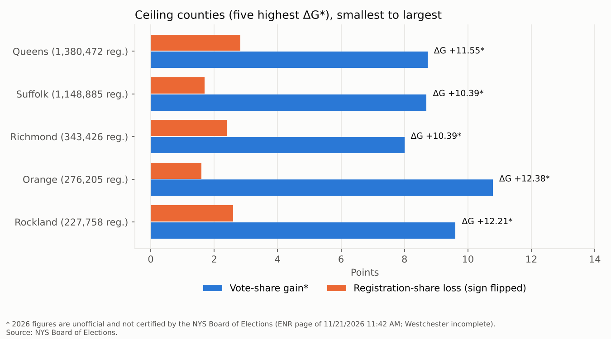
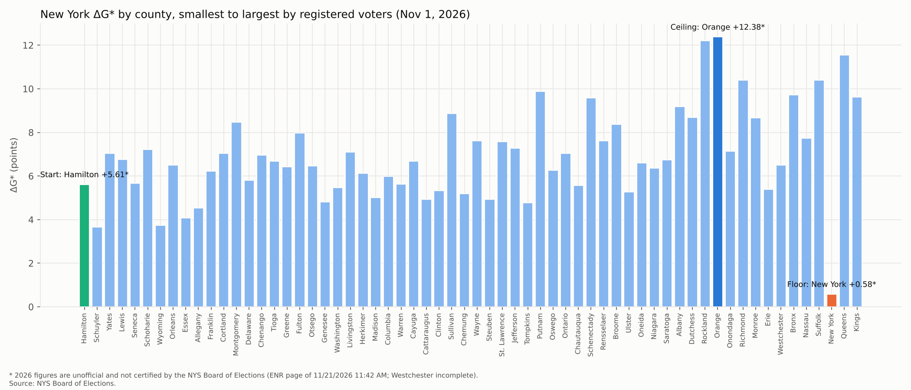

# Floor and Ceiling Counties

> **\*2026 figures are unofficial and not certified by the NYS Board of Elections.** They come from the Board's Election Night Reporting page as of 11/21/2026 11:42 AM. The Board says that page leaves out a significant number of unscanned emergency Election Day ballots from Westchester County, and six counties were not at full reporting (see [Sources](Home#sources)). Governor race unless a page says otherwise. Votes are a candidate's votes on every party line he or she appeared on (fusion voting), not a count of registered Democrats who voted. Registration is the Nov 1 enrollment report for each year (active + inactive). These pages measure a pattern; they make no claim about intent, fraud or cause.

## How to read floor and ceiling counties

Look for the pattern at both ends. The ceiling counties are the ones with the highest ΔG; in New York those are Orange, Rockland, Queens, Richmond, Suffolk. The floor counties are the ones with the lowest ΔG.

- **The floor** is the single county with the lowest ΔG in the state. In New York that's New York County (Manhattan), at +0.58\*.
- **The ceiling** is the single county with the highest ΔG in the state. In New York that's Orange, at +12.38\*.

Every state will have its own floor and ceiling. Those two extremes set the range the rest of that state's counties fall within. In New York every county's ΔG is positive, so even the floor is a rise.

## Terminology

- **Ceiling counties** are the five counties with the largest positive ΔG: Orange +12.38\*, Rockland +12.21\*, Queens +11.55\*, Richmond +10.39\*, Suffolk +10.39\*. Unlike Nebraska, two of New York's five (Orange, Queens) **gained** registered Democrats, so they are non-loss counties and do not run the residual step. The highest-ΔG county that lost registered Democrats (the top residual county) is Rockland (+12.21\*; surplus 9.61\*; gap +19,116\*).
- **Floor** counties have the lowest ΔG: New York +0.58\*, Schuyler +3.65\*, Wyoming +3.74\*. New York County stands well apart: the next-lowest county is Schuyler, 3.08 points higher. New York County already had the state's highest Hochul vote share in 2022 (82.10%); it moved only to 82.17%\*.
- **Non-loss counties** (also called **share-gain counties**) had no Democratic registration loss. They get raw numbers only, with no residual step. There are 13, largest first:
  - Kings: registered Democrats 1,147,500 → 1,184,803; Hochul all-line votes 402,114 → 493,734\*.
  - Queens: registered Democrats 830,745 → 835,420; Hochul all-line votes 277,280 → 355,969\*.
  - New York: registered Democrats 795,607 → 832,410; Hochul all-line votes 372,149 → 397,886\*.
  - Westchester: registered Democrats 334,221 → 342,767; Hochul all-line votes 198,202 → 228,581\*.
  - Orange: registered Democrats 98,857 → 99,652; Hochul all-line votes 54,386 → 67,696\*.
  - Dutchess: registered Democrats 80,773 → 82,243; Hochul all-line votes 55,519 → 63,452\*.
  - Saratoga: registered Democrats 54,073 → 56,439; Hochul all-line votes 48,183 → 53,613\*.
  - Ulster: registered Democrats 57,067 → 58,490; Hochul all-line votes 44,583 → 47,295\*.
  - Rensselaer: registered Democrats 35,144 → 36,508; Hochul all-line votes 28,521 → 33,182\*.
  - Ontario: registered Democrats 24,663 → 24,797; Hochul all-line votes 20,166 → 23,831\*.
  - Tompkins: registered Democrats 35,568 → 36,829; Hochul all-line votes 25,319 → 26,737\*.
  - Warren: registered Democrats 13,433 → 13,732; Hochul all-line votes 12,373 → 14,381\*.
  - Columbia: registered Democrats 19,852 → 19,885; Hochul all-line votes 16,079 → 17,442\*.
- **Registration fell and votes fell too.** No New York county is in this group: Hochul's all-line votes rose in all 62.

## Ceiling and floor detail

**Ceiling:** Orange and Rockland are the only counties with ΔG above +12; Queens, Richmond, Suffolk are next. 3 of the five (Rockland, Queens, Richmond) began 2022 with a negative G (Hochul's vote share behind Democratic registration share) and turned positive in 2026. Democratic registration share fell in all five, even in the two that gained registered Democrats, because all registration grew faster.

**Floor:** No county's ΔG fell. Every county's gap in votes is positive (smallest: Hamilton, +202\*).

| County | G 2022 | G 2026* | ΔG* | Dem reg share 2026 | Dem reg 2022 → 2026 | Hochul votes 2022 → 2026* | Registration fell? |
|---|---|---|---|---|---|---|---|
| Orange | +6.13 | +18.51 | +12.38 | 36.1% | 98,857 → 99,652 | 54,386 → 67,696 | No (non-loss) |
| Rockland | −1.76 | +10.44 | +12.21 | 43.1% | 100,238 → 98,072 | 47,854 → 65,936 | Yes |
| Queens | −0.07 | +11.47 | +11.55 | 60.5% | 830,745 → 835,420 | 277,280 → 355,969 | No (non-loss) |
| Richmond | −7.18 | +3.22 | +10.39 | 38.2% | 136,794 → 131,119 | 47,135 → 55,770 | Yes |
| Suffolk | +7.28 | +17.67 | +10.39 | 32.6% | 380,756 → 374,951 | 235,736 → 270,778 | Yes |
| Wyoming | +1.32 | +5.05 | +3.74 | 18.3% | 5,402 → 4,770 | 3,292 → 3,424 | Yes |
| Schuyler | +7.15 | +10.81 | +3.65 | 25.8% | 3,581 → 3,452 | 2,661 → 2,775 | Yes |
| New York | +11.67 | +12.25 | +0.58 | 69.9% | 795,607 → 832,410 | 372,149 → 397,886 | No (non-loss) |

Statewide, ΔG rose in 62 of 62 counties (median about +6.68).

*Ceiling counties: ΔG\* split into vote-share gain and registration-share loss.*

*All 62 counties, ΔG in size order (registered voters), floor New York and ceiling Orange marked.*

---
**Related:** [Bottom-Up Reverse Math](Reverse-Math) · [Graphs](Graphs) · [Locked New York Formula](Locked-New-York-Formula) · [Home](Home)
