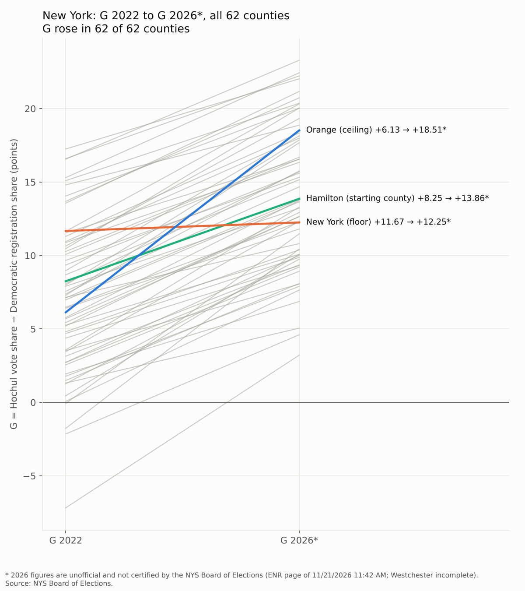
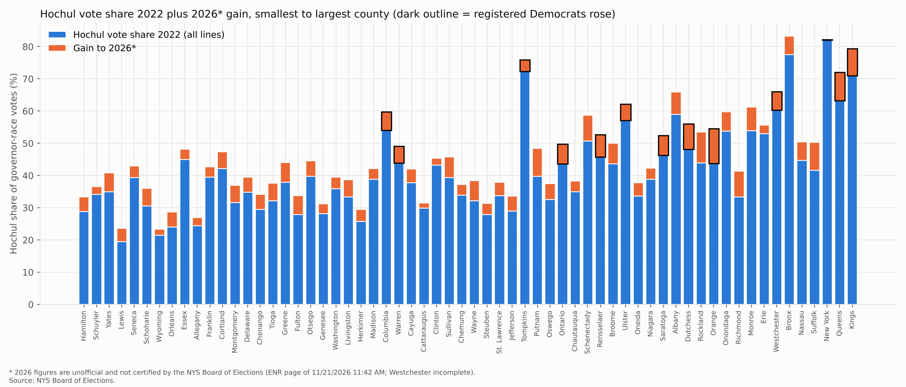
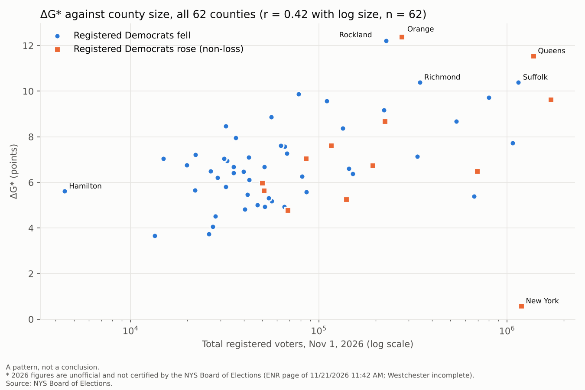
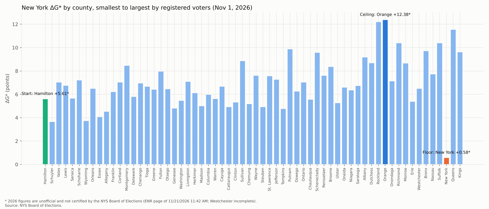
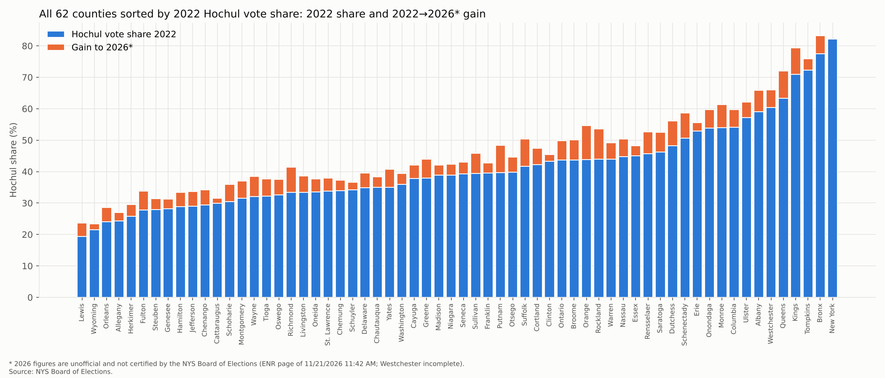
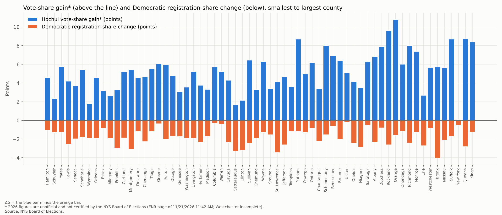
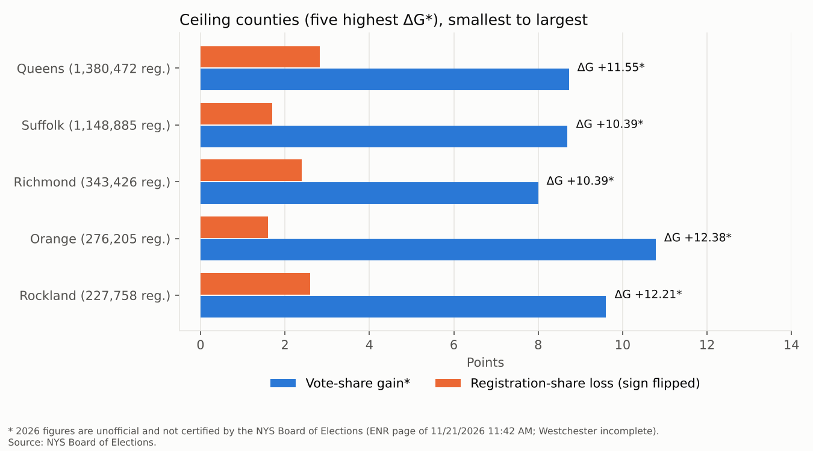
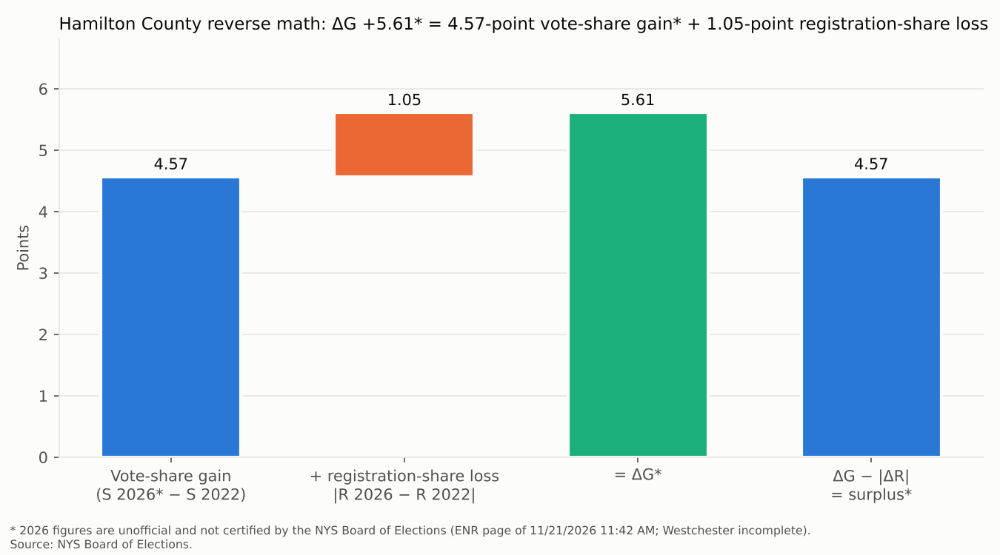
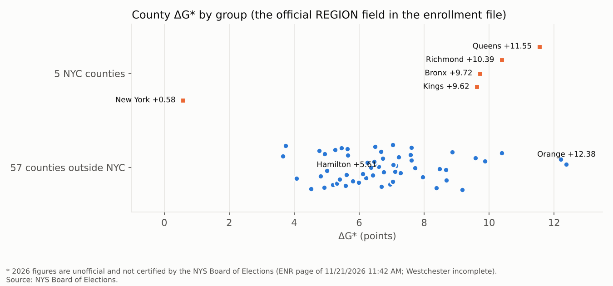

# Graphs

> **\*2026 figures are unofficial and not certified by the NYS Board of Elections** (Election Night Reporting page, 11/21/2026 11:42 AM; Westchester count incomplete). Governor race unless noted. Hochul votes are all lines (Democratic + Working Families). Registration is the Nov 1 enrollment report. County size is total registered voters, Nov 1, 2026 (this wiki uses only NYS BOE data, so no census population). These charts measure a pattern; they make no claim about intent, fraud or cause.

## 1. County slope chart

*Each line is one county, G 2022 to G 2026\*. G rose in 62 of 62 counties; the ceiling (Orange) rose most steeply and the floor (New York) was nearly flat.*

## 2. Stacked bars

*2022 Hochul share plus 2026 gain\*, all 62 counties smallest to largest; dark outline marks the non-loss counties.*

## 3. ΔG by county size

*ΔG\* against county size (registered voters, log scale), all 62 counties (r = 0.42, n = 62). Larger counties tend to have higher ΔG; treat as a pattern, not a conclusion.*

*All 62 counties in size order. Floor: New York (+0.58\*). Ceiling: Orange (+12.38\*).*

## 4. Vote-share gain vs registration loss

*All 62 counties sorted by 2022 Hochul vote share. Blue is the 2022 share; orange is the 2022 to 2026 gain\*.*

*Hochul vote-share gain\* (above the line) and Democratic registration-share change (below the line), all 62 counties smallest to largest.*

## 5. Ceiling counties

*Ceiling counties: Orange +12.38\*, Rockland +12.21\*, Queens +11.55\*, Richmond +10.39\*, Suffolk +10.39\*.*

## 6. Hamilton County (starting county)

*Hamilton reverse math: ΔG +5.61\* = 4.57-point vote-share gain\* + 1.05-point registration-share loss.*

*County ΔG\* by group: 57 counties outside NYC (mean +6.80\*) and the 5 NYC counties (mean +8.37\*).*

---
**Related:** [Hamilton County Audit](Hamilton-County-Audit) · [Bottom-Up Reverse Math](Reverse-Math) · [Floor and Ceiling Counties](Floor-and-Ceiling) · [Home](Home)
