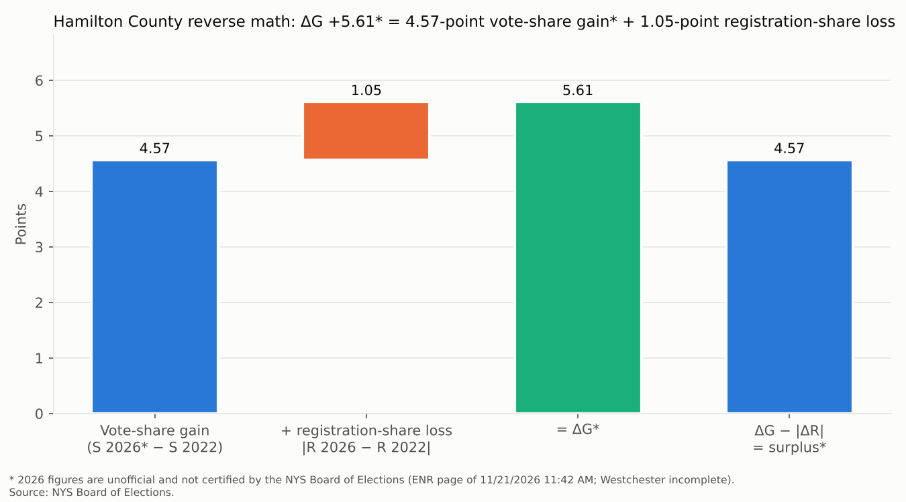
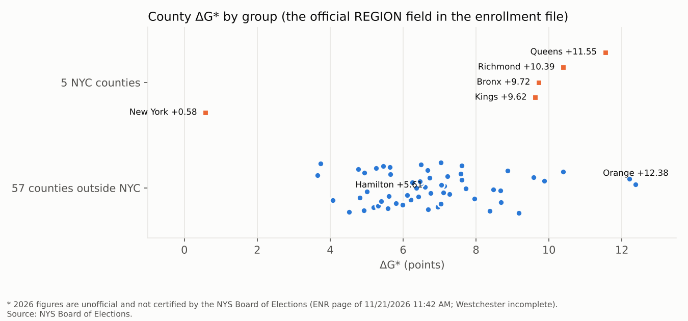

# Bottom-Up Reverse Math

> **\*2026 figures are unofficial and not certified by the NYS Board of Elections.** They come from the Board's Election Night Reporting page as of 11/21/2026 11:42 AM. The Board says that page leaves out a significant number of unscanned emergency Election Day ballots from Westchester County, and six counties were not at full reporting (see [Sources](Home#sources)). Governor race unless a page says otherwise. Votes are a candidate's votes on every party line he or she appeared on (fusion voting), not a count of registered Democrats who voted. Registration is the Nov 1 enrollment report for each year (active + inactive). These pages measure a pattern; they make no claim about intent, fraud or cause.

The same arithmetic at three levels, from one county up to the whole state. Race-votes denominator (governor race, every party line, write-ins included, blank and void excluded). **Fusion lines:** Hochul = Democratic + Working Families. Zeldin (2022) = Republican + Conservative. Blakeman (2026) = Republican + Conservative + Vote Affordable; the Board's own Blakeman total includes the Vote Affordable line, so it is counted here and shown separately.

## Step 1: Hamilton County

| Step | Value |
|---|---|
| Hochul vote share (all lines) | 28.83% (2022) → 33.40%* (2026): **+4.57 points*** |
| Democratic registration share | 20.59% → 19.54%: **−1.05 points** |
| ΔG = vote-share growth − registration-share change | 4.57 − (−1.05) = **+5.61 points*** |
| Reverse step: ΔG − registration-share loss | 5.61 − 1.05 = 4.57 (the vote-share surplus) |
| Gap in votes | 961* − 831 × (871 ÷ 953) = **about +202*** |

All shares and points are shown rounded to two decimals and computed from unrounded values, so a sum of rounded figures can differ from the shown total by 0.01.

## Step 2: the 57 counties outside New York City

The group is the official "Outside NYC" region in the NYS BOE enrollment file: every county except the five boroughs. Hamilton is one of them. Largest to smallest by registered voters (Nov 1, 2026).

| County | Registered 2026 | Dem reg 2022 → 2026 | Hochul votes 2022 → 2026* | Vote-share growth* (pts) | Registration-share change (pts) | ΔG* (pts) | Gap* |
|---|---|---|---|---|---|---|---|
| Suffolk | 1,148,885 | 380,756 → 374,951 | 235,736 → 270,778 | +8.70 | −1.69 | +10.39 | +38,636 |
| Nassau | 1,071,540 | 422,062 → 401,119 | 232,036 → 242,958 | +5.62 | −2.10 | +7.72 | +22,436 |
| Westchester | 693,360 | 334,221 → 342,767 | 198,202 → 228,581 | +5.67 | −0.82 | +6.49 | +25,311 |
| Erie | 668,890 | 305,682 → 292,986 | 180,626 → 197,935 | +2.69 | −2.71 | +5.39 | +24,811 |
| Monroe | 537,422 | 221,244 → 220,258 | 148,751 → 167,229 | +7.39 | −1.28 | +8.67 | +19,141 |
| Onondaga | 334,202 | 124,926 → 124,780 | 91,410 → 104,366 | +6.00 | −1.14 | +7.13 | +13,063 |
| Orange | 276,205 | 98,857 → 99,652 | 54,386 → 67,696 | +10.78 | −1.60 | +12.38 | +12,873 |
| Rockland | 227,758 | 100,238 → 98,072 | 47,854 → 65,936 | +9.61 | −2.60 | +12.21 | +19,116 |
| Dutchess | 223,642 | 80,773 → 82,243 | 55,519 → 63,452 | +7.88 | −0.80 | +8.68 | +6,923 |
| Albany | 221,450 | 108,374 → 105,692 | 69,035 → 77,696 | +6.85 | −2.32 | +9.17 | +10,369 |
| Saratoga | 193,259 | 54,073 → 56,439 | 48,183 → 53,613 | +6.24 | −0.49 | +6.73 | +3,322 |
| Niagara | 151,708 | 53,339 → 50,666 | 29,669 → 32,965 | +3.50 | −2.87 | +6.37 | +4,783 |
| Oneida | 143,954 | 45,438 → 42,650 | 25,358 → 29,429 | +4.14 | −2.46 | +6.60 | +5,627 |
| Ulster | 139,942 | 57,067 → 58,490 | 44,583 → 47,295 | +5.05 | −0.21 | +5.27 | +1,600 |
| Broome | 134,311 | 50,323 → 46,080 | 29,799 → 33,887 | +6.39 | −1.99 | +8.38 | +6,601 |
| Rensselaer | 115,895 | 35,144 → 36,508 | 28,521 → 33,182 | +6.96 | −0.64 | +7.61 | +3,554 |
| Schenectady | 110,345 | 42,657 → 42,646 | 27,632 → 32,411 | +8.03 | −1.54 | +9.57 | +4,786 |
| Chautauqua | 85,843 | 25,394 → 23,985 | 15,237 → 16,708 | +3.35 | −2.23 | +5.57 | +2,316 |
| Ontario | 85,262 | 24,663 → 24,797 | 20,166 → 23,831 | +6.19 | −0.85 | +7.05 | +3,555 |
| Oswego | 81,324 | 18,116 → 17,812 | 13,115 → 15,330 | +4.95 | −1.31 | +6.26 | +2,435 |
| Putnam | 78,228 | 23,970 → 23,879 | 16,413 → 20,771 | +8.69 | −1.18 | +9.87 | +4,420 |
| Tompkins | 68,396 | 35,568 → 36,829 | 25,319 → 26,737 | +3.60 | −1.18 | +4.77 | +520 |
| Jefferson | 67,682 | 17,056 → 16,002 | 9,204 → 10,240 | +4.67 | −2.61 | +7.28 | +1,605 |
| St. Lawrence | 65,958 | 21,796 → 19,953 | 11,591 → 13,474 | +4.12 | −3.45 | +7.58 | +2,863 |
| Steuben | 65,516 | 15,060 → 14,420 | 9,666 → 10,916 | +3.39 | −1.54 | +4.93 | +1,661 |
| Wayne | 62,650 | 14,653 → 14,224 | 10,814 → 12,685 | +6.31 | −1.30 | +7.61 | +2,188 |
| Chemung | 56,133 | 16,439 → 15,361 | 9,474 → 10,528 | +3.29 | −1.89 | +5.18 | +1,675 |
| Sullivan | 55,962 | 19,564 → 18,745 | 9,759 → 11,182 | +6.44 | −2.43 | +8.87 | +1,832 |
| Clinton | 54,265 | 18,433 → 17,438 | 11,894 → 13,150 | +2.14 | −3.17 | +5.32 | +1,898 |
| Cattaraugus | 51,557 | 13,882 → 12,722 | 7,795 → 8,509 | +1.67 | −3.26 | +4.93 | +1,365 |
| Cayuga | 51,442 | 15,566 → 14,540 | 10,175 → 11,633 | +4.31 | −2.38 | +6.68 | +2,129 |
| Warren | 51,000 | 13,433 → 13,732 | 12,373 → 14,381 | +5.25 | −0.38 | +5.63 | +1,733 |
| Columbia | 50,049 | 19,852 → 19,885 | 16,079 → 17,442 | +5.70 | −0.28 | +5.98 | +1,336 |
| Madison | 47,212 | 12,508 → 12,075 | 10,192 → 11,430 | +3.32 | −1.69 | +5.01 | +1,591 |
| Herkimer | 42,742 | 10,318 → 9,245 | 5,753 → 6,444 | +3.75 | −2.37 | +6.12 | +1,289 |
| Livingston | 42,440 | 10,748 → 10,170 | 8,136 → 9,486 | +5.22 | −1.88 | +7.10 | +1,788 |
| Washington | 41,761 | 9,905 → 9,655 | 7,946 → 9,076 | +3.55 | −1.91 | +5.46 | +1,331 |
| Genesee | 40,530 | 9,202 → 8,563 | 6,274 → 6,728 | +3.09 | −1.73 | +4.82 | +890 |
| Otsego | 39,889 | 11,950 → 11,749 | 8,795 → 9,712 | +4.81 | −1.65 | +6.47 | +1,065 |
| Fulton | 36,133 | 7,787 → 7,243 | 5,255 → 6,288 | +5.95 | −2.01 | +7.96 | +1,400 |
| Greene | 35,309 | 9,664 → 9,640 | 7,651 → 8,374 | +6.05 | −0.37 | +6.42 | +742 |
| Tioga | 35,213 | 8,661 → 8,453 | 6,117 → 7,025 | +5.49 | −1.19 | +6.68 | +1,055 |
| Chenango | 32,572 | 7,461 → 6,998 | 4,968 → 5,856 | +4.68 | −2.26 | +6.95 | +1,196 |
| Delaware | 32,097 | 8,896 → 8,727 | 6,490 → 7,054 | +4.59 | −1.21 | +5.80 | +687 |
| Montgomery | 32,049 | 9,352 → 8,722 | 5,028 → 5,646 | +5.38 | −3.09 | +8.47 | +957 |
| Cortland | 31,324 | 9,569 → 9,090 | 6,812 → 7,662 | +5.18 | −1.86 | +7.04 | +1,191 |
| Franklin | 29,042 | 10,261 → 9,698 | 6,003 → 6,820 | +3.25 | −2.96 | +6.21 | +1,146 |
| Allegany | 28,227 | 5,751 → 5,338 | 3,868 → 4,259 | +2.62 | −1.91 | +4.52 | +669 |
| Essex | 27,369 | 8,136 → 8,025 | 6,992 → 7,611 | +3.18 | −0.88 | +4.06 | +714 |
| Orleans | 26,623 | 5,394 → 5,169 | 3,292 → 3,939 | +4.58 | −1.91 | +6.49 | +784 |
| Wyoming | 26,092 | 5,402 → 4,770 | 3,292 → 3,424 | +1.81 | −1.92 | +3.74 | +517 |
| Schoharie | 22,135 | 5,456 → 5,159 | 3,923 → 4,515 | +5.45 | −1.76 | +7.22 | +806 |
| Seneca | 21,960 | 6,347 → 6,078 | 4,551 → 5,021 | +3.69 | −1.97 | +5.66 | +663 |
| Lewis | 19,850 | 4,107 → 3,770 | 2,068 → 2,365 | +4.18 | −2.57 | +6.75 | +467 |
| Yates | 14,955 | 3,499 → 3,407 | 2,901 → 3,407 | +5.78 | −1.26 | +7.03 | +582 |
| Schuyler | 13,404 | 3,581 → 3,452 | 2,661 → 2,775 | +2.35 | −1.31 | +3.65 | +210 |
| Hamilton | 4,457 | 953 → 871 | 831 → 961 | +4.57 | −1.05 | +5.61 | +202 |

ΔG is positive in **all 57 of 57** (+3.65 to +12.38, mean +6.80). Registered Democrats 3,013,527 → 2,956,390; Hochul all-line votes 1,886,173 → 2,132,804\*. Registered Democrats fell in 47 of the 57; the other 10 are non-loss counties (see [Floor and Ceiling Counties](Floor-and-Ceiling#terminology)).

## Step 3: all of New York

| Group | Counties | Hochul vote share | Dem registration share | Vote-share growth* | Reg-share change | Pooled ΔG* | County mean ΔG* (range) | Gap* | Residual votes* |
|---|---|---|---|---|---|---|---|---|---|
| 57 counties outside NYC | 57 | 45.87% → 52.03%* | 38.00% → 36.29% | +6.16 | −1.71 | +7.87 | +6.80 (+3.65 to +12.38) | +282,393 | +322,768 |
| 5 NYC counties | 5 | 69.68% → 76.10%* | 67.27% → 65.32% | +6.42 | −1.95 | +8.36 | +8.37 (+0.58 to +11.55) | +234,345 | +165,406 |
| All 62 counties | 62 | 53.12% → 59.86%* | 49.59% → 47.89% | +6.74 | −1.70 | +8.44 | +6.93 (+0.58 to +12.38) | +502,795 | +513,028 |

The five NYC counties are Kings, Queens, New York, Bronx, Richmond (largest first). ΔG is positive in 62 of 62 counties. Pooled ΔG is computed from summed votes and registration for the group; the county mean is the simple average of county ΔG values. The "Gap" column applies the gap formula to each group's totals.

> **Hypothesis label.** Turning ΔG into "residual votes" (denominator × ΔG ÷ 100) and calling them injected or offset votes is a hypothesis the arithmetic cannot test. The same number reflects turnout changes, crossover voting, unenrolled ("blank") voters, the Westchester count still in progress, and any other cause. Candidate votes are not turnout.

*Hamilton residual steps: ΔG +5.61\* = 4.57-point vote-share gain\* + 1.05-point registration-share loss.*

*County ΔG\* for the 57 counties outside NYC and the 5 NYC counties.*

---
**Related:** [Hamilton County Audit](Hamilton-County-Audit) · [Locked New York Formula](Locked-New-York-Formula) · [Floor and Ceiling Counties](Floor-and-Ceiling) · [Home](Home)
